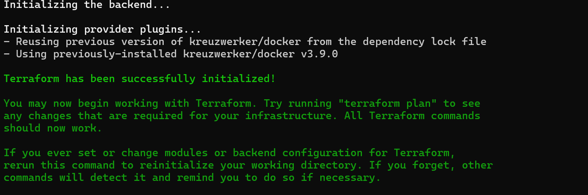
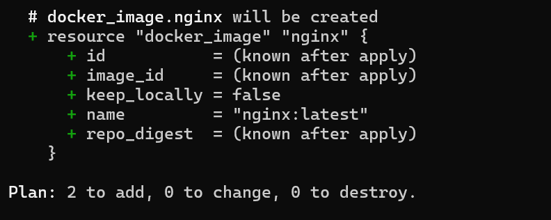
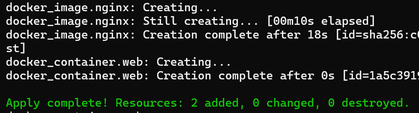
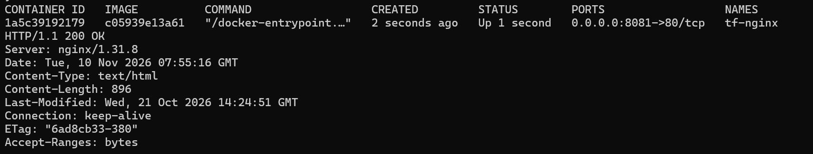
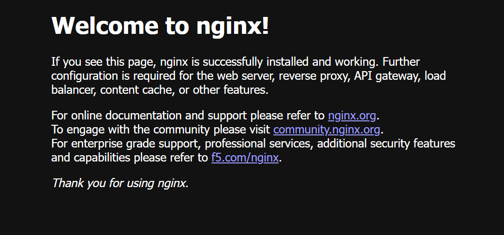
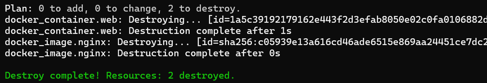

# Task 3: Infrastructure as Code with Terraform

## What I did
- Used the Terraform **Docker provider** (`kreuzwerker/docker`) to provision a local Docker container.
- `main.tf` pulls the `nginx` image and runs a container `tf-nginx`, exposing it on port **8081**.
- Ran the workflow: `init` -> `plan` -> `apply` -> `state list/show` -> `destroy`.
- Logs are in `logs/`, screenshots in `screenshots/`.

## How to run
```bash
terraform init
terraform plan
terraform apply
terraform state list
curl -I http://localhost:8081
terraform destroy
```
Or run `./run.sh` to execute everything and save logs automatically.


## Screenshots






